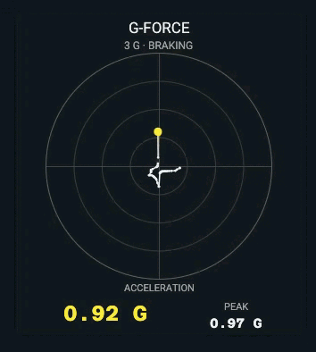
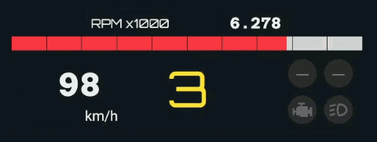
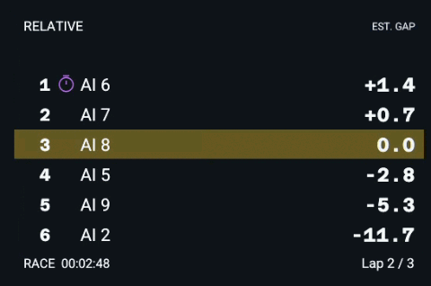

# lfs-openradar

OpenRadar supports LFS 0.8C29. It is a standalone overlay for Live for Speed with a proximity radar,
a speed and indicator dashboard, input telemetry, a G-force meter, fuel range and refuelling estimates,
estimated gaps to the cars ahead and behind,
and a real-time performance delta
against your best clean lap in the current session. Each gadget has its own
position, scale, and visibility settings. Automatic backend selection uses the
native Wayland HUD on supported KDE/KWin sessions and independent gadget windows
elsewhere. You can also choose either backend explicitly.

It connects to your local LFS client through InSim, OutSim, and OutGauge. Regular players
can use it in multiplayer without the server's admin password. Windows is the
primary platform; Linux/X11 support is experimental.

> [!NOTE]
> I’m building this project with plenty of AI help behind the scenes.
> I have mixed feelings about LLMs, but they help me keep development moving
> and spend more time racing.

## Features

- [Local OutSim/OutGauge recording, with an optional InSim connection](docs/local-recording.md)
- Proximity radar
- [G-force meter with a fading trail and measured peaks](docs/usage.md#g-force-meter)
- [Steering and pedal inputs with a simple throttle/brake history graph](docs/usage.md#input-telemetry)
- [Speed, gear, RPM, and warning indicators](docs/configuration.md#speed-dashboard)
- [Fuel level, laps until empty, and additional fuel needed to finish](docs/usage.md#fuel)
- [Per-track/car PB lap splits and independent best sectors](docs/usage.md#lap-records)
- [Seven-row on-track Relative panel with session timing and lapped traffic](docs/usage.md#relative)
- Real-time gap ahead/behind indicator
- [Session lap-time log with session best and previous-lap deltas](docs/usage.md#lap-time-log)
- Lap performance delta

## Gadget showcase

<table>
  <tr>
    <td width="50%" align="center">
      <strong>G-force meter</strong>  
      
    </td>
    <td width="50%" align="center">
      <strong>Speed dashboard</strong>  
      
    </td>
  </tr>
  <tr>
    <td width="50%" align="center">
      <strong>Relative</strong>  
      
    </td>
    <td width="50%" align="center">
      <strong>and more...</strong>  
      <a href="https://youtu.be/zHja2vsNfss">Check the YouTube demo here</a> 
      Older version
    </td>
  </tr>
</table>

## Quick Setup

1. [Download](https://github.com/ernowo-git/lfs-openradar/releases), extract, and launch OpenRadar with LFS closed.
2. In **Settings → LFS startup setup**, select your LFS folder and click **Enable InSim at startup**, **Configure OutSim**, and **Configure OutGauge**.
3. Start LFS, click **Apply / reconnect**, enable **Show overlays**, and drive your car.
4. Enable your gadgets, use **Position mode** to place them, then turn it off and click **Save settings**.

See the [installation guide](docs/installation.md) for details.

## Table of contents

- [Installation](docs/installation.md): downloads, first configuration, and connecting LFS.
- [Usage](docs/usage.md): quick start, gadget behavior, and platform status.
- [Development](docs/development.md): prerequisites, building, and testing.
- [Configuration](docs/configuration.md): config paths, passwords, and telemetry settings.
- [Native Wayland HUD](docs/native-wayland.md): KDE/KWin launch, monitor selection, and verification limits.
- [LFS startup setup](docs/lfs-startup-setup.md): automatic InSim, backups, and port conflicts.
- [Troubleshooting](docs/troubleshooting.md): connection, positioning, and graphics issues.
- [CI and releases](docs/ci-and-releases.md): checks, version bumps, builds, and recovery.
- [Product roadmap](docs/roadmap.md): planned widgets and architecture.
- [v0.2 release notes](docs/release-notes-v0.2.md) and [historical release plan](docs/release-v0.2.md).
- [Radar implementation plan](docs/proximity-radar-plan.md): telemetry research and acceptance criteria.
- [Graphics freeze investigation](docs/graphics-freeze-investigation.md): evidence and mitigations.
- [Contributing](#contributing)
- [License](#license)

## Contributing

Open an issue for bugs or feature proposals, or submit a PR from a feature
branch. Include the problem, the resulting behavior, and how you checked it.
For overlay issues, include your OS, GPU/driver, LFS version, display mode, and
relevant graphics-log output. Remove passwords from any shared configuration.

Run the [development checks](docs/development.md#testing) and update
documentation when behavior or configuration changes. Keep changes to the
vendored eframe patch documented in
[its patch notes](vendor/eframe/OPENRADAR-PATCH.md).

Release versions must match in Cargo.toml and Cargo.lock. A higher version
merged into `main` triggers automatic tags, release notes, and Windows/Linux
downloads; unchanged versions skip publication. See
[CI and releases](docs/ci-and-releases.md) for the release process.

## License

Copyright (c) 2026 ernowo-git.

OpenRadar is free software licensed under the
[GNU General Public License v3.0 only](LICENSE) (`GPL-3.0-only`). You may
redistribute and modify it under GPL v3. Distributed modified versions must
provide their corresponding source code under GPL v3. The software comes
without any warranty; see the license for the full terms.

Earlier versions published under MIT retain their original MIT permissions.

Third-party components retain their own licenses. The vendored eframe patch
includes its [MIT license](vendor/eframe/LICENSE-MIT) and
[patch documentation](vendor/eframe/OPENRADAR-PATCH.md). Bundled fonts use the
[SIL Open Font License 1.1](docs/font-licenses.md).
